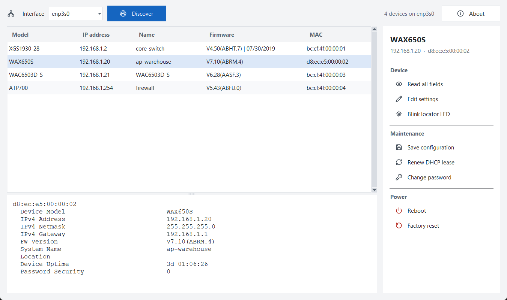
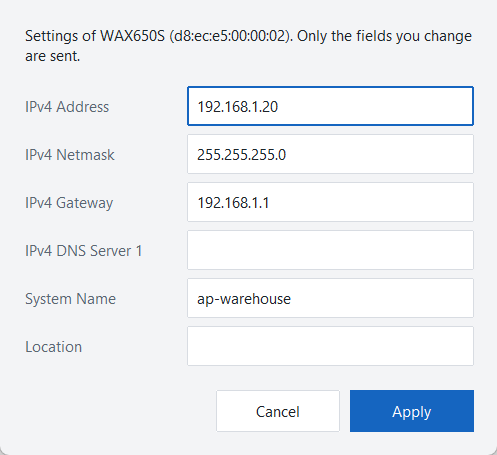
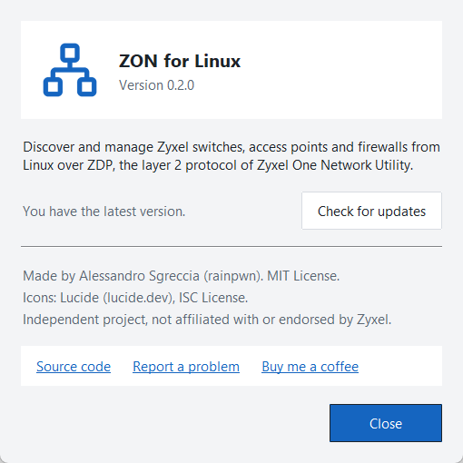

# zyxel-zon-linux

[](https://github.com/rainpwn/zyxel-zon-linux/releases/latest)

[](https://buymeacoffee.com/rainpwn)

Discover and manage Zyxel switches, access points and firewalls from Linux, using the same layer 2 protocol as Zyxel One Network Utility (ZON).

Write-up: [Zyxel ZON and SecuExtender, now on Linux](https://rainpwn.blog/blog/zyxel-tools-on-linux/)

Tested on XGS1930-28, XGS1930-28HP, XGS1935-28, WAX650S, WAC6503D-S and ATP700. See [Status](#status) for what has been tested on which device, and [report your device](https://github.com/rainpwn/zyxel-zon-linux/issues/new?template=device-report.yml) if it is not listed.

## Why this exists

I run networks for clients as an MSP, and most of them are built on Zyxel gear. ZON is the tool I reach for whenever I land on a network: it finds every Zyxel device on the segment in a few seconds, with model, firmware, IP and name, and it handles the routine maintenance that follows.

ZON only runs on Windows. My workstation runs Linux, so the answer was simply that I could not do this from my own machine. There is no Linux build, no documented protocol, and no open-source replacement.

So I reverse engineered ZON and wrote one. `zon.py` is a single Python file with no dependencies outside the standard library. `zon-gui.py` adds a graphical interface on top of it.

## What it does

```
$ sudo ./zon.py eth0
 #  MAC                Device Model        IPv4 Address        FW Version          System Name
 1  bc:cf:4f:00:00:01  XGS1930-28          192.168.1.2         V4.50(ABHT.7) | 07/30/2019  core-switch
 2  d8:ec:e5:00:00:02  WAX650S             192.168.1.20        V7.10(ABRM.4)       ap-warehouse
 3  bc:cf:4f:00:00:03  WAC6503D-S          192.168.1.21        V6.28(AASF.3)       WAC6503D-S
ZON for Linux - type 'help' for commands
zon> show 3
bc:cf:4f:00:00:03
  Device Model                           WAC6503D-S
  FW Version                             V6.28(AASF.3)
  IPv4 Address                           192.168.1.21
  IPv4 Netmask                           255.255.255.0
  IPv4 Gateway                           192.168.1.1
  Device Uptime                          3d 01:06:26
  ...
```

Commands in the shell:

| Command | What it does | Password |
|---|---|---|
| `discover [seconds]` | Find devices and read their details | no |
| `show N` | Every field read during discovery | no |
| `query N field ...` | Read any field without a password | no |
| `fields` | List the protocol fields and who may read or write them | no |
| `get N [field ...]` | Authenticated read, e.g. `get 3 serial` | yes |
| `set N field value ...` | Change IP, netmask, gateway, DNS, name, location, SNMP, syslog... | yes |
| `save N` | Save the running configuration | yes |
| `locate N [on\|off]` | Blink the locator LED | yes |
| `reboot N` | Reboot | yes |
| `renew N` | Renew the DHCP lease | yes |
| `factory_reset N` | Reset to factory defaults | yes |
| `passwd N` | Change the admin password | yes |
| `logout [N]` | Forget stored passwords | |

`N` is the row number from `discover` (devices are sorted by IP) or the device MAC. `--debug` prints every packet sent and received in hex. Every command also runs one-shot, for scripts:

```
sudo ./zon.py eth0 --json discover > inventory.json
sudo ./zon.py eth0 get 3 serial
```

## Graphical interface

`zon-gui.py` shows the same device list as ZON on Windows: pick the interface, press Discover, select a device and use the buttons on the right (read all fields, edit IP/name/location, locate, save, renew, change password, reboot, factory reset).



<p>
  
  
</p>

```
./zon-gui.py [eth0]
```

Start it as your normal user. It runs `zon.py --serve` as root through `pkexec`, so the system asks for your password once per interface. It needs `zon.py` in the same directory, Tkinter (`python3-tk` on Debian/Ubuntu, `python3-tkinter` on Fedora) and polkit.

At startup the GUI asks the GitHub API for the latest release and shows a link in the toolbar when a newer version exists. Nothing else is sent. About shows the version and checks again on request.

## Status

Some of this has run against real devices and some has only run against a simulated device built from my reading of ZON. The table says which is which, so you know what to report if something breaks.

| Feature | Status |
|---|---|
| Discovery and details | Tested on hardware: XGS1930-28 and XGS1930-28HP (V4.50, V4.70), XGS1935-28 (V4.90), WAX650S (V7.10), WAC6503D-S (V6.28), ATP700 (V5.43) |
| `get` (authenticated read), `reboot` | Tested on hardware: WAC6503D-S (V6.28) |
| `set`, `save`, `locate`, `renew`, `factory_reset` | Implemented, tested against a simulated device only. They use the same signed request as `reboot` |
| `passwd` | Implemented, tested against a simulated device only. Try it first on a device you can reset by hand |
| Firmware upgrade over TFTP | Not implemented |
| `zon-gui.py` | New in 0.2.0. Tested on Linux with real devices |

If an authenticated command works or fails on your hardware, please open an issue with the model, the firmware version and the output of `show N`. The salt and the Password Security mode in that output are not secrets.

## Requirements

- Linux with Python 3.8 or later
- Root, because the tool sends raw Ethernet frames
- `openssl` on the PATH, only for devices that use Password Security modes 1 to 3
- A wired or wireless interface on the same LAN or VLAN as the devices

ZDP is a layer 2 protocol. It does not cross routers, VPN tunnels or IP-only links, exactly like ZON on Windows. To manage a remote site, run `zon.py` on a Linux machine inside that LAN and reach it over SSH.

## Install

```
curl -O https://raw.githubusercontent.com/rainpwn/zyxel-zon-linux/main/zon.py
chmod +x zon.py
sudo ./zon.py eth0
```

For the graphical interface, download `zon-gui.py` next to it as well:

```
curl -O https://raw.githubusercontent.com/rainpwn/zyxel-zon-linux/main/zon-gui.py
chmod +x zon-gui.py
./zon-gui.py
```

## Passwords

Each device declares how it derives its authentication key from the admin password, in a field called Password Security. `show N` displays it; the WAC6503D-S access points I tested do not report it, which means mode 0. Modes 1 to 3 send a salt encrypted with AES keys that ZON carries in its binary. `zon.py` includes those keys and decrypts the salt with `openssl`.

## How it works

[PROTOCOL.md](PROTOCOL.md) documents the protocol: frame format, request codes, the 48 fields, how the authentication key is derived, and how a password change is encoded. It also marks which parts were observed on hardware and which were read from the ZON binary.

## Legal

This is an independent project. It is not affiliated with, endorsed by or supported by Zyxel. Zyxel, ZON and Nebula are trademarks of their respective owners.

The protocol was recovered by decompiling ZON for the sole purpose of interoperability with Linux, which Article 6 of EU Directive 2009/24/EC allows when the information is not otherwise available. This note is not legal advice.

The tool can reboot devices, change their addresses and reset them to factory defaults. Use it at your own risk, and read the Status section before running write commands on production equipment.

## Support

If this tool saved you some time, you can [buy me a coffee](https://buymeacoffee.com/rainpwn).

## License

MIT. See [LICENSE](LICENSE).

Alessandro Sgreccia
